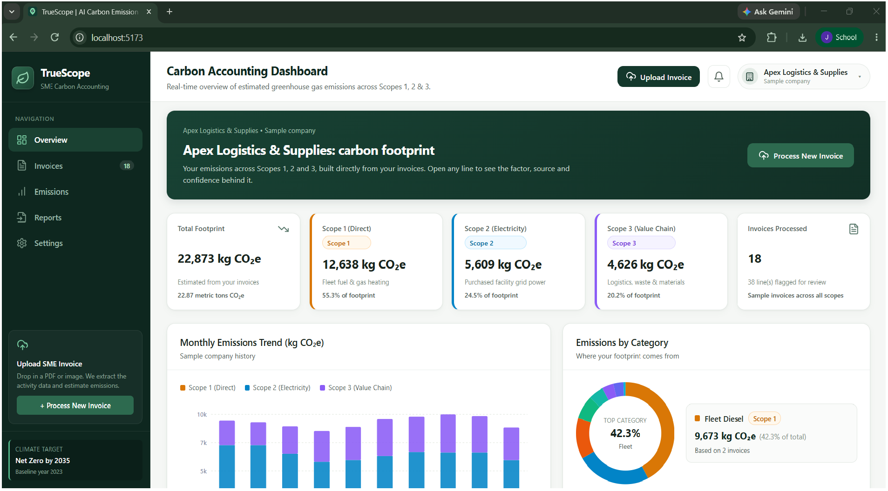
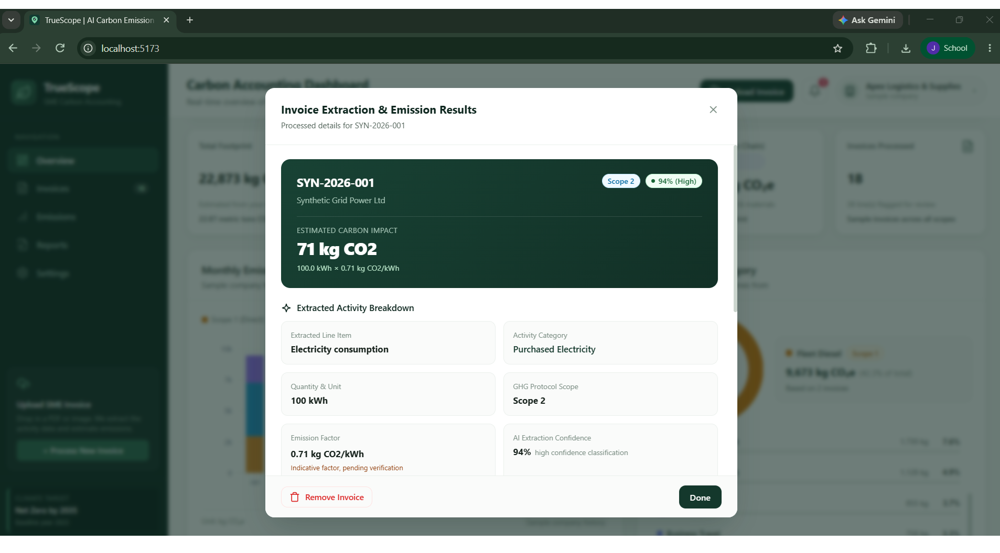
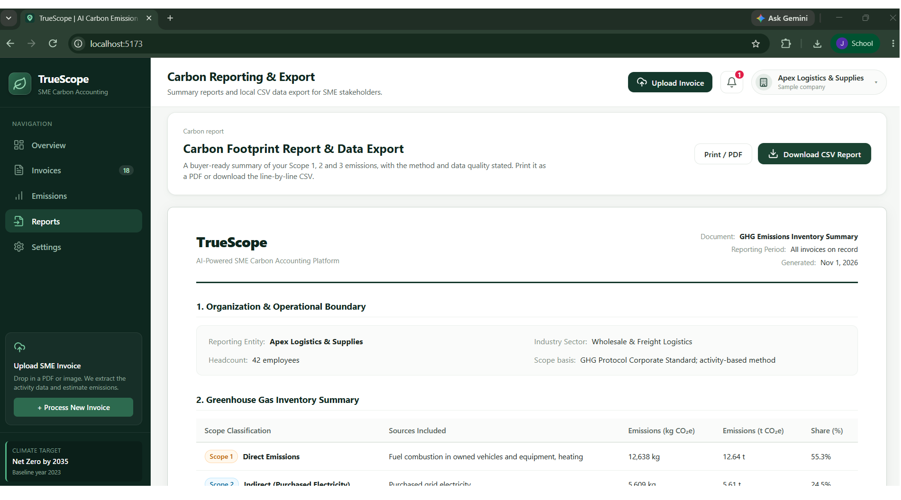

<div align="center">

# 🌍 TrueScope

### An AI-powered carbon ledger that turns invoices into Scope 1, 2 and 3 emission estimates

*Upload an invoice. Get a traceable carbon estimate in minutes.*


**PCCOE International Grand Challenge 2026 · Pune, India**

[🎥 Demo video](#-demo-video) · [🚀 Run it locally](#-run-it-locally) · [🧪 Try it in one click](#-try-it-in-one-click) · [⚠️ Limitations](#-honest-limitations)

</div>

---

## 💡 The problem

Small and medium businesses (SMEs) are increasingly asked by buyers for carbon data, but they have no ESG team, no expertise, and no budget for consultants. Yet they already hold the raw data: **their invoices**. Electricity bills, fuel receipts and freight invoices all describe real activity, but that data almost never becomes carbon data.

## ✅ Our solution

TrueScope reads an invoice, understands what was bought, and estimates the emissions behind it, with every number traced to its source.

> **Invoice → OCR → Extraction → Classification → Emission calculation → Carbon ledger → Report**

---

## 🎥 Demo video

📺 **YouTube link:** *(coming soon)*

## 📸 Screenshots

### Dashboard


### Invoice extraction and emission results


### Reports


---

## ⚙️ How it works

| Step | What happens |
|---|---|
| 1. **Upload** | The user uploads a PDF, PNG or JPG invoice in the web app. |
| 2. **OCR** | Tesseract reads the text from the document. |
| 3. **Parse** | The parser extracts vendor, date, invoice number and line items (item, quantity, unit). |
| 4. **Classify** | Each line gets an activity category and a GHG Protocol scope (1, 2 or 3). |
| 5. **Calculate** | The emission engine multiplies the activity amount by an emission factor. |
| 6. **Check** | Confidence is scored, duplicate invoices are blocked, and lines with incompatible units are **flagged for review instead of guessed**. |
| 7. **Report** | A dashboard, category breakdown, Print/PDF report and CSV export are generated. |

**Example:** 100 kWh of grid electricity × 0.71 kg CO₂/kWh = **71 kg CO₂** (Scope 2).

## ✨ Key features

- **End-to-end pipeline:** from invoice image or PDF to an emission estimate.
- **Scope 1, 2 and 3 mapping** following the GHG Protocol.
- **Traceable numbers:** every line shows its emission factor, source, geography and confidence score.
- **Honest by design:** unverified factors are labelled as indicative, and unsupported units are never guessed.
- **Duplicate detection:** the same invoice cannot be counted twice for a company.
- **Multi-company workspaces:** each company keeps its own invoices and totals.
- **Reports:** a Print/PDF summary and a line-by-line CSV export.
- **Supported categories:** grid electricity, fleet diesel, fleet petrol, natural gas, freight transport, waste disposal, business travel, packaging materials, and water & effluent.

## 🧱 Tech stack

| Layer | Technology |
|---|---|
| Frontend | React, Vite |
| Backend | Python, FastAPI |
| AI pipeline | Tesseract OCR (pytesseract), pdf2image/Poppler, rule-based parser and classifier |
| Emission engine | Python, JSON emission-factor library |
| Database | SQLite *(PostgreSQL planned)* |

## 📁 Project structure

```
TrueScope/
├── frontend/          React dashboard
├── backend/           FastAPI API, storage and reporting
├── ai/                OCR, parser, classifier and confidence scoring
├── emission-engine/   Emission factors and calculation engine
├── database/          SQLite project structure
├── sample-invoices/   Synthetic test invoices
└── docs/              Demo script and presentation
```

---

## 🧪 Try it in one click

After starting the app, click **Upload Invoice** and choose one of the **Example invoices**. They load the real images from [sample-invoices](./sample-invoices/), so you can run the full pipeline immediately. The electricity example is explicitly synthetic, not a real bill, and produces **71 kg CO₂** with the current unverified demo factor.

If you see *"already uploaded for this company"*, that is the duplicate check working. Delete the existing invoice from the **Invoices** page, or switch company, and upload again.

---

## 🚀 Run it locally

### Local demonstration setup (Windows PowerShell)

Install the Python dependencies from the repository root:

```powershell
python -m venv .venv
.\.venv\Scripts\Activate.ps1
python -m pip install -r backend\requirements.txt -r ai\requirements.txt
```

Install Node.js, then install the frontend dependencies:

```powershell
Set-Location frontend
npm.cmd ci
```

### OCR tools (needed for real invoice uploads)

- **Tesseract OCR** (needed for PNG, JPG and PDF): install the Windows build from UB Mannheim. It is found automatically in `C:\Program Files\Tesseract-OCR\`.
- **Poppler** (needed for PDF only): download the **Release** zip from the `oschwartz10612/poppler-windows` GitHub releases and extract it, for example to `C:\poppler`. Then create `ai/.env` (see [ai/.env.example](./ai/.env.example)) and set:

  ```
  POPPLER_PATH=C:\poppler\poppler-26.09.0\Library\bin
  ```

More detail is in [ai/README.md](./ai/README.md). Restart the API after changing `ai/.env`.

### Start the app

Open two PowerShell terminals at the repository root. Start the API in the first:

```powershell
.\.venv\Scripts\Activate.ps1
python -m uvicorn backend.main:app --reload --reload-dir backend --reload-dir ai --reload-dir emission-engine --host 127.0.0.1 --port 8000
```

Start the frontend in the second:

```powershell
Set-Location frontend
npm.cmd run dev
```

Open the frontend URL printed by Vite (normally `http://localhost:5173`). The API allows the Vite development origins `localhost` and `127.0.0.1` on ports 5173–5179, so it continues to work if Vite selects a fallback port.

- Health check: `http://127.0.0.1:8000/api/health`
- API docs: `http://127.0.0.1:8000/docs`
- `VITE_API_BASE_URL` can be set in `frontend/.env` to change the API address.

---

## ⚠️ Honest limitations

TrueScope is a **working prototype**. We chose to be transparent about what is and isn't verified.

- The dashboard starts with synthetic frontend mock data. Uploaded invoice results and predefined API demo records are stored in `database\truescope.sqlite3` and restored by the frontend after reload. Raw uploaded files are temporary and deleted after processing. Frontend company settings and edits to mock rows remain in memory only.
- Set `TRUESCOPE_DATABASE_PATH` before starting the API to use a different SQLite file. Keep the database local and protected, because it may contain invoice metadata and extracted line descriptions.
- Invoice processing is synchronous. Supported formats are PDF, PNG, JPG and JPEG, with a 10 MiB limit. OCR works best on clear, printed, English invoices.
- **Emission factors are a limited demonstration library. They are unverified and must not be treated as authoritative reporting values.** See [the factor inventory and evidence audit](./emission-engine/README.md) for recorded values, provenance gaps, and the evidence required before verification. The library's India value is a default only, not a proven geography for each factor, and an unresolved electricity source-year conflict is not reported as a confirmed year.
- No paper or stationery factor is provided. Rows with unsupported category and unit combinations are left uncalculated and flagged for review. Quantities such as packs or individual units are never converted to mass.
- A partial emission calculation does not mean extraction failed. Review skipped line items and warnings before using calculated subtotals.
- Reports are labelled draft/demo outputs and are not certified regulatory disclosures. Totals include eligible uploaded values labelled as kg CO₂e only. CO₂-only, skipped, failed or invalid rows are kept for review but excluded. Synthetic demo values are shown separately and never added to uploaded totals. The monthly trend chart is static synthetic data and does not include uploaded invoices.

## 🛣️ Roadmap

- Verify emission factors against official sources (CEA, DEFRA, EPA) with documented year and geography
- Support more categories and invoice layouts
- Cloud OCR adapter (AWS Textract) for harder documents
- PostgreSQL storage and cloud deployment
- ERP and procurement integrations, and multi-supplier reporting
- CSV and bulk invoice upload

---

## ✅ Validation commands

From the repository root:

```powershell
python -m pytest -q
python -m unittest discover -s emission-engine -p "test_engine.py" -v
```

From `frontend`:

```powershell
npm.cmd test
npm.cmd run lint
npm.cmd run build
```

---

## 👥 Team

**Vishwakarma Institute of Technology, Pune** · Second-year B.Tech, Computer Science

| Name | Focus |
|---|---|
| **Jiya Barage** | Frontend and system integration |
| **Shivani Bankar** | AI pipeline: OCR, parsing, classification, confidence scoring |
| **Aditya Baviskar** | Emission engine, factor verification, unit validation |
| **Nikhil Bhandarkawathekar** | Backend: invoice processing and reporting |

Built for the **PCCOE International Grand Challenge 2026** under the theme **AI for Climate Change**.

---

<div align="center">

*TrueScope makes carbon reporting as simple as uploading an invoice.*

</div>